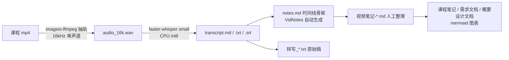

# Work_Schedule

极客/饥人谷「山竹记账全栈版」课程视频的**转写与笔记整理工作区**：把课程 mp4 转成逐字稿，再沉淀成课程笔记、需求文档与概要设计文档。

本目录同时是一个 Git 仓库（`main` 分支），仓库只跟踪 0.30 MB 的文本成果，约 976 MB 的本地环境与中间产物全部由 `.gitignore` 排除。

## 目录结构

```
Work_Schedule/
├─ 山竹记账需求文档.md          需求文档（含 8 个 mermaid 图表）
├─ 山竹记账概要设计文档.md       概要设计（含 6 个 mermaid 图表）
├─ 概要设计-课程笔记.md          第 30 讲课程笔记
├─ 需求文档怎么写-课程笔记.md     第 28 讲课程笔记
├─ 使用用例图描述功能-课程笔记.md  第 30 讲（用例图）课程笔记
├─ 老板问几天做完项目-课程笔记.md  排期/项目管理课程笔记
├─ 转写_*.txt                  8 份原始逐字稿（含「-纯文本」清洗版）
├─ transcribe_03.py            转写脚本（仅 notes_03 这一讲留下了脚本）
├─ notes/ ~ notes_04/          4 讲视频的完整加工产物，结构一致：
│   ├─ 视频笔记-XXX.md          人工整理的视频笔记
│   ├─ notes.md                VidNotes 自动生成的时间线骨架
│   ├─ transcript.md/.txt/.srt 逐字稿（带时间戳 / 纯文本 / 字幕）
│   └─ audio_16k.wav           中间音频（已忽略）
├─ .gitignore
├─ requirements.txt              Python 依赖（faster-whisper、imageio-ffmpeg）
├─ package.json / package-lock.json
├─ .venv/  .models/  node_modules/   ← 均为本地环境，已忽略
```

四讲内容对应关系：`notes` = 老板问几天做完项目，`notes_02` = 需求文档怎么写，`notes_03` = 使用用例图描述功能，`notes_04` = 概要设计。

## 处理流程



`transcribe_03.py` 的要点：

- 抽取音频：`imageio_ffmpeg.get_ffmpeg_exe()` 调 ffmpeg，参数 `-vn -ac 1 -ar 16000`，已存在则跳过（`--force` 可强制重抽）；
- 识别：`faster_whisper.WhisperModel("small", device="cpu", compute_type="int8", download_root=".models")`，`language="zh"`、`beam_size=5`；
- 输出：`transcript.md`（带 `[hh:mm:ss,SSS]` 时间戳）、`transcript.txt`（秒级时间戳）。

输入输出全部走命令行参数，不再写死路径：

```powershell
# 只看参数解析结果，不跑模型
.\.venv\Scripts\python.exe transcribe_03.py --video "F:\...\3. 使用用例图描述功能.mp4" --out notes_03 --dry-run

# 实际转写
.\.venv\Scripts\python.exe transcribe_03.py --video "F:\...\3. 使用用例图描述功能.mp4" --out notes_03

# 换模型/换语言/开 VAD
.\.venv\Scripts\python.exe transcribe_03.py --video in.mp4 --out notes_05 --model medium --language auto --vad-filter
```

| 参数 | 默认值 | 说明 |
| --- | --- | --- |
| `--video` | 必填 | 输入视频或音频路径 |
| `--out` | `notes_03` | 输出目录，不存在自动创建 |
| `--model` | `small` | tiny / base / small / medium / large-v3 或本地模型路径 |
| `--models-dir` | `<项目>/.models` | 模型缓存目录，按脚本所在目录解析 |
| `--language` | `zh` | 传 `auto` 自动检测 |
| `--beam-size` | `5` | 正整数校验 |
| `--device` / `--compute-type` | `cpu` / `int8` | 有 GPU 可传 `cuda` + `float16` |
| `--vad-filter` | 关闭 | 开启静音过滤 |
| `--voice` / `--title` | `audio_16k.wav` / 视频文件名 | 中间音频名、md 标题 |
| `--force` / `--dry-run` | 关闭 | 强制重抽音频、仅打印参数 |

> 注意：`.srt` 不是这个脚本产出的，生成它的脚本未入库。

## 复现环境

Python 端（3.11.5，`.venv`）：

```powershell
python -m venv .venv
.\.venv\Scripts\pip.exe install -r requirements.txt
.\.venv\Scripts\python.exe transcribe_03.py --video "F:\...\3. 使用用例图描述功能.mp4" --out notes_03
```

`requirements.txt` 锁死两个直接依赖（faster-whisper 1.2.1、imageio-ffmpeg 0.8.1）。当前实测的传递依赖版本：ctranslate2 4.9.0、onnxruntime 1.32.0、av 18.1.0、tokenizers 0.23.3、numpy 2.4.6。

Node 端（仅用于 mermaid 图表渲染/校验，devDependencies）：

```powershell
npm install     # 按 package-lock.json 还原
npm ls --depth=0
```

`package.json` 只记录两个直接依赖并锁死版本：`mermaid 10.9.8`、`jsdom 31.0.1`；其余 121 个包（d3、cytoscape、katex、dompurify、dagre-d3-es、elkjs 等）都是 mermaid 的传递依赖，由 `package-lock.json` 保证可还原。

## .gitignore 判定依据

判定原则只有一条：**该文件能否由仓库内的内容重新生成**。能，则忽略。

| 路径 | 体积 | 文件数 | 忽略理由 |
| --- | --- | --- | --- |
| `.venv/` | 398.1 MB | 5408 | Python 虚拟环境，`pyvenv.cfg` 记录了 `C:\Python311`，可重建 |
| `.models/` | 463.7 MB | 14 | HuggingFace 的 faster-whisper-small 缓存，脚本首次运行自动下载 |
| `node_modules/` | 67.9 MB | 4962 | npm 依赖，`package.json` + lock 可还原 |
| `notes*/audio_16k.wav` | 46.8 MB | 4 | 从视频抽取的 16 kHz 音频，纯中间产物 |
| `__pycache__`、`*.py[cod]`、`*.log`、`*.tmp`、`Thumbs.db`、`.vscode/` 等 | — | — | 编译缓存、日志、系统与编辑器杂项 |

刻意**保留**的：`transcript.srt/.md/.txt`、`notes.md`、`转写_*.txt`。它们虽然也是脚本产物，但属于本仓库的真正成果，且体积只有几百 KB。

## 已知缺口（后续可补）

1. 四讲视频只有一讲留下了转写脚本，其余三讲的 `.srt` 与笔记生成链路无代码可复现。
2. `package.json` 只声明了 mermaid/jsdom，仓库里没有对应的渲染脚本，出图流程仍是手工的。
3. 仓库未加 `.gitattributes`，Windows 工作区是 CRLF、仓库内是 LF，跨平台协作时可能看到整文件换行差异。
