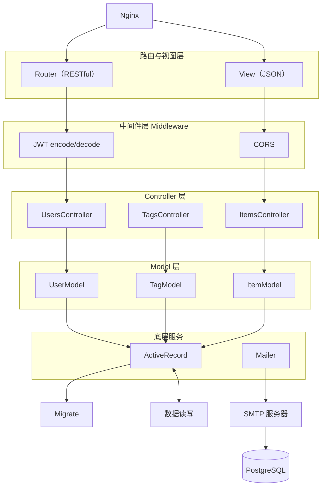
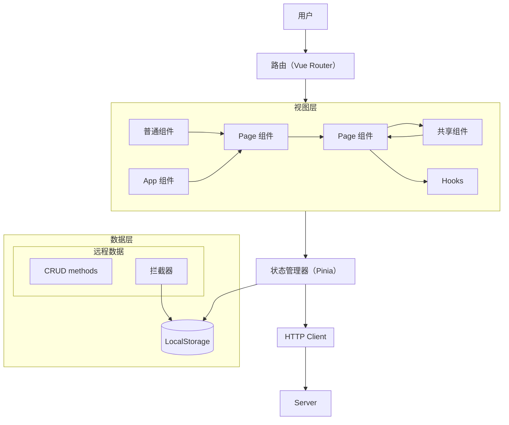
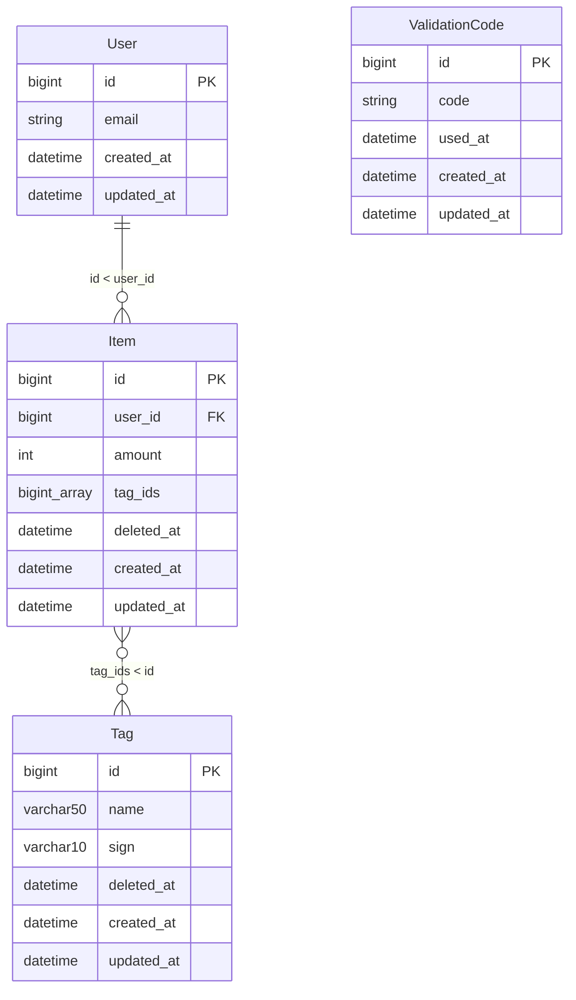
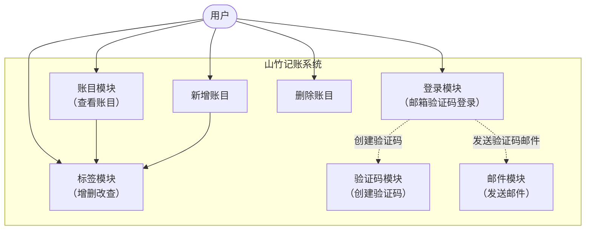
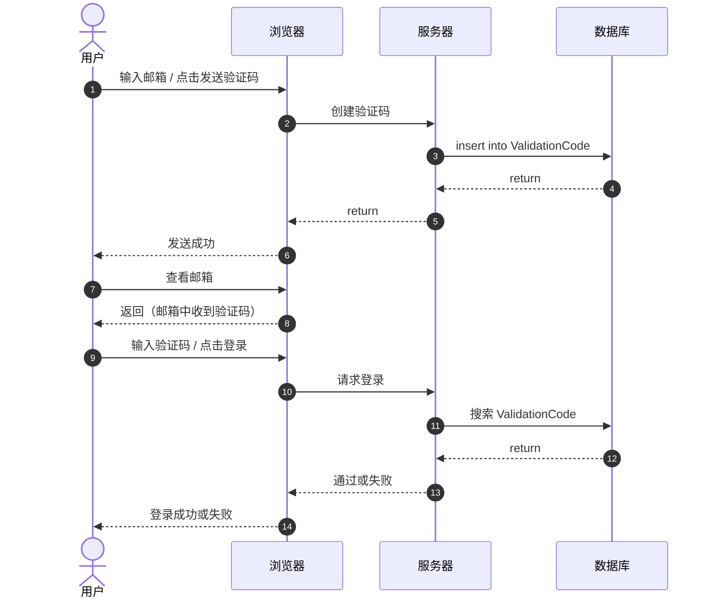
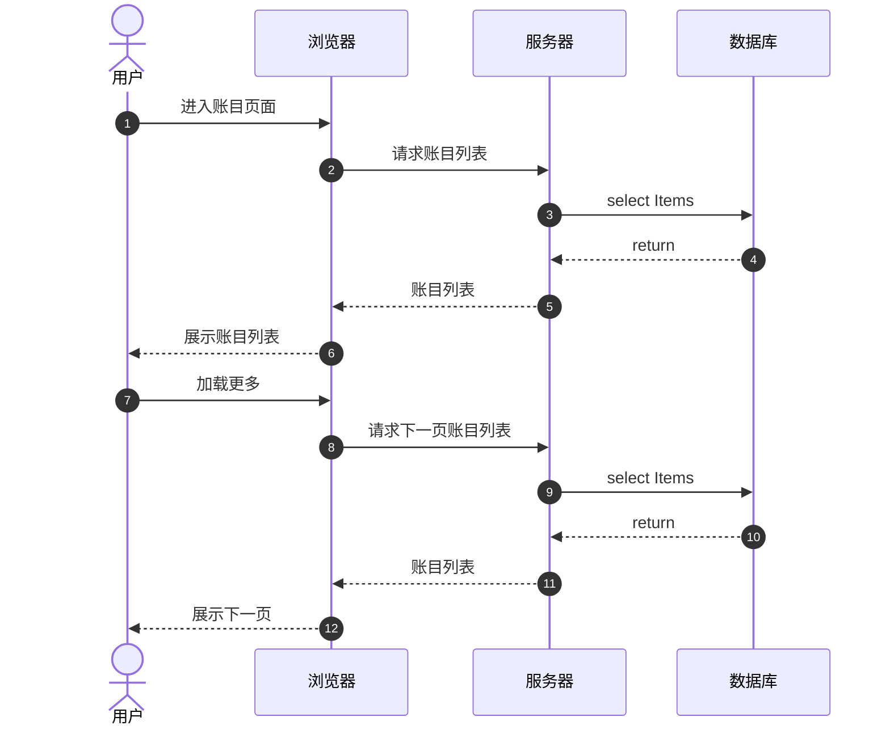

# 山竹记账概要设计

> 《山竹记账》视频课程配套文档
>
> 杭州饥人谷教育科技有限公司
>
> 作者：方应杭
>
> 链接：[课程链接](https://xiedaimala.com/courses/89c07499-0174-40e3-81ce-a9eca822de40/)

## 引言

### 撰写目的

此文档的撰写目的是描述如何将山竹记账需求文档中所列的功能转化为可实现的软件系统，以方便项目开发人员了解山竹记账系统的功能需求、非功能需求、模块划分和设计思路等。开发人员应按照此文档描述的系统架构进行各模块开发。

### 术语表

| 中文 | 英文 | 含义 |
| --- | --- | --- |
| 山竹记账 | Mangosteen | 产品名称，同时也是系统名称 |
| 账目 | item | 用户每记录一笔收入或支出，就相当于创建一个账目 |
| 标签 | tag | 用户可以给一个账目添加多个标签 |
| 验证码 | valication code | 用户可以使用邮箱和验证码登录 |

### 变更记录

2046年1月1日，完成第一版文档。

## 设计思路

### 概要设计

本系统是一个典型的 B/S 架构，分为前端和后端两大模块，前端和后端主要通过 HTTP 进行通信（即前后端分离），必要时也可以采用 [WebSockets](https://developer.mozilla.org/en-US/docs/Web/API/WebSockets_API) 和 [Server-sent events](https://developer.mozilla.org/en-US/docs/Web/API/Server-sent_events) 进行通信。

数据库方面，考虑到需求文档涉及到的数据结构层次分明，符合关系型数据的特征，所以采用关系型数据库管理系统 PostgreSQL 来管理数据。

### 后端设计



> **说明（原文图示转换说明）**：原图为 Word 形状绘制的分层架构图，已按其层级与箭头关系转换为 Mermaid `flowchart`。原图中 `ActiveRecord` 层的「数据读写」为双向箭头、「Migrate」为单向向下箭头；`SMTP 服务器`框内嵌有 PostgreSQL 标志图片，此处以 `PostgreSQL` 节点表示。`TagModel` 与 `TagsController` 的箭头在原图中因位置贴近而与相邻框体存在视觉重叠，其连接关系按同层同列对齐推断。

从下到上依次为：底层服务、Model 层、Ctrontroller 层、中间件、路由与视图、反向代理

部署时可以采用容器化技术将整个系统分为三个容器：Proxy、App 和 DB。容器之间通过约定好的端口进行通信。

### 前端设计

图中箭头表示调用关系



> **说明（原文图示转换说明）**：原图为 Word 形状绘制的前端分层调用关系图，已转换为 Mermaid `flowchart`。原图中 `Server` 位于最上方、`用户` 位于最下方，箭头自下而上依次为：用户 → 路由（Vue Router）→ 视图层 → 状态管理器（Pinia）→ 数据层（HTTP Client / LocalStorage）→ Server。原图 `HTTP Client` 框内包含 `CRUD methods` 与 `拦截器` 两个子框，转换时两者保留在同一层分组内。

前端从下到上依次是：路由、视图层、状态管理层、数据层。其中数据层分为远程数据和本地数据。远程数据使用 Axios.js 作为 HTTP Client 与服务器通信，本地数据直接使用 LocalStorage 作为媒介。

### 数据库设计



> **说明（原文图示转换说明）**：原图为数据库表结构图（dbdiagram.io 生成），已转换为 Mermaid `erDiagram`。原图中 `Item.tag_ids` 为数组类型，与 `Tag.id` 呈多对多引用；`Item.user_id` 对 `User.id` 呈一对多引用。

各表的伪代码描述如下：

#### 用户表

```
Table User {
  id bigint [pk, increment]
  email string
  created_at datatime
  updated_at datetime
}
```

#### 验证码表

```
Table ValidationCode {
  id bigint [pk, increment]
  code string
  used_at datetime
  created_at datatime
  updated_at datetime
}
```

#### 账目表

```
Table Item {
  id bigint [pk, increment]
  user_id bigint
  amount int // 以「分」为单位
  tag_ids bigint[]
  deleted_at datatime
  created_at datatime
  updated_at datetime
}
```

#### 标签表

```
Table Tag {
  id bigint [pk, increment]
  name varchar(50)
  sign varchar(10)
  deleted_at datetime
  created_at datatime
  updated_at datetime
}
```

除此之外还有索引，伪代码描述如下：

```
Ref: "Item"."tag_ids" < "Tag"."id"
Ref: "User"."id" < "Item"."user_id"
```

## 模块划分

本章节根据需求文档对系统进行模块划分。

### 系统用例图



> **说明（原文图示转换说明）**：原文档在「模块划分」章节未包含独立的用例图，本用例图系依据该章节及各模块子章节的文字描述整理绘制（参与者、用例、系统边界、包含关系与关联关系）。原文档中实际提供的图形为登录流程与账目列表的时序图，已分别转换于下文「登录模块」与「账目模块」处。

### 登录模块



> **说明（原文图示转换说明）**：原图为登录流程时序图（参与者：用户、浏览器、服务器、数据库；系统边界：浏览器为前端、服务器为后端、数据库为数据层），已转换为 Mermaid `sequenceDiagram`。原图中实线箭头为请求/调用方向，虚线箭头为返回/响应方向。

如果用户频繁请求发送验证码，那么系统应该拒绝并提示剩余的重置时间。

#### 账目模块



> **说明（原文图示转换说明）**：原图为账目列表加载流程时序图（参与者：用户、浏览器、服务器、数据库），已转换为 Mermaid `sequenceDiagram`。

一、查看账目

若账目数量为零，则前端需要展示醒目的新增记账按钮。

若没有下一页账目，则前端需要提示没有更多数据了。

二、新增账目

新增账目页面是一个典型的表单页面，用户输入必要的信息即可提交表单，提交成功与否都需要进行提示。

三、删除账目

基于实现难度考虑，删除账目应实现为软删除，若用户迫切需要硬删除，可由人工操作。

删除前需要用户点击确认，因为此操作不可撤销。

#### 标签模块

标签模块与账目模块类似，系统向用户提供方便的增删改查界面和接口即可。

#### 验证码模块

验证码对用户只提供创建接口，创建完验证码后，只能在系统内部进行查询。

#### 邮件模块

邮件模块不对外提供接口，只向系统内部提供发邮件功能。

## 非功能需求

响应时间：要求每个操作从用户结束交互行为到得到反馈的总时长不超过三秒。

可靠性：系统尽量 24 小时不间断提供服务，最低可用率为 99%。

环境要求：系统后端服务器须运行在 Linux 操作系统上（Kernel 版本不低于 4.15），前端须运行在 Chrome 浏览器上（版本不低于 80）。

技术栈：后端可使用 Ruby、Golang、Java 等语言，前端可使用 Vue 2、Vue 3、React 等技术。

数据备份：数据库尽量每小时备份一次，操作日志尽量每天备份一次，且系统可随时恢复至某个已备份的状态。

数据安全：密码不得保存明文，应用密钥不得明文提交到版本控制系统中，不得使用已被认为不安全的保密手段（如 MD5）。

可扩展性：目前不考虑可扩展性。
