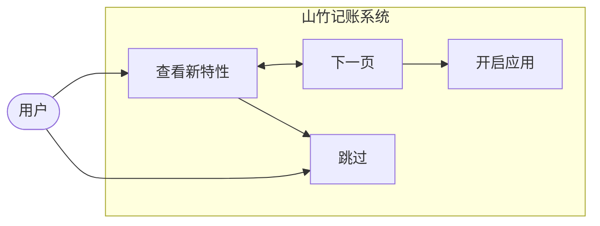
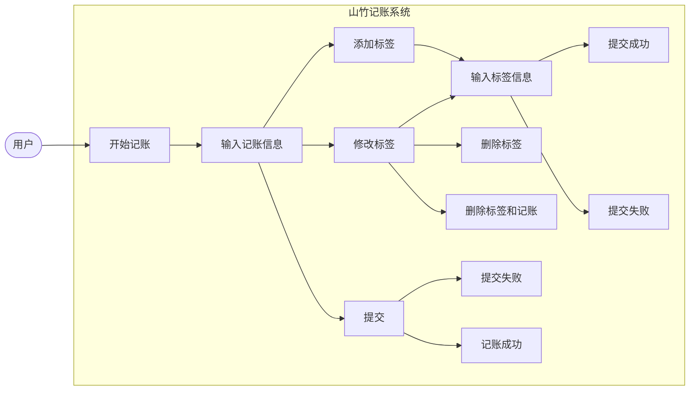
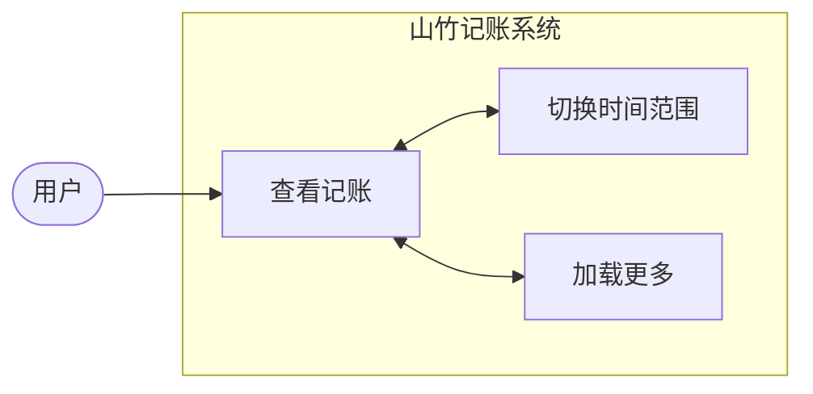
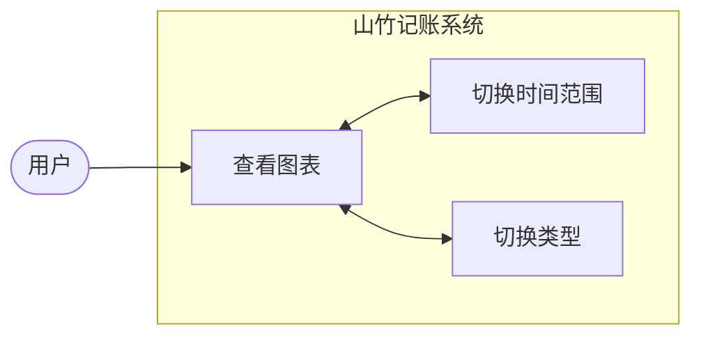
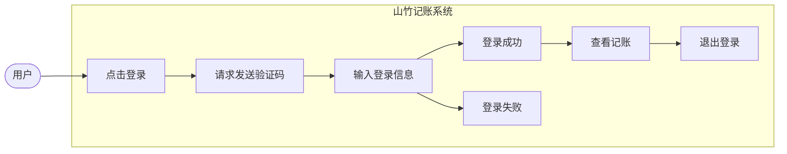
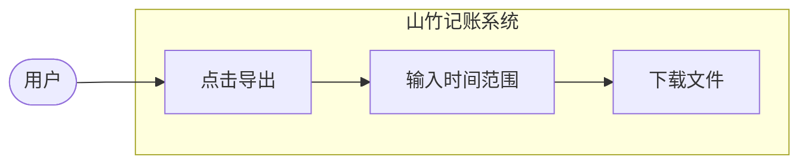
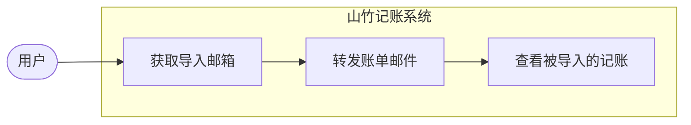
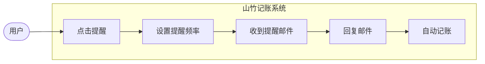

杭州饥人谷教育科技有限公司

**山竹记账需求文档**

《山竹记账》视频课程配套文档

作者：方应杭  
链接：[课程链接](https://xiedaimala.com/courses/89c07499-0174-40e3-81ce-a9eca822de40)

---

# 山竹记账需求文档

## 变更记录

2046年1月1日，完成第一版文档。

## 项目背景

本项目是本人为了提升自己的技术能力以及职场竞争力而做的项目。

为了提升技术能力，所以本项目采用了本人之前不常用的技术栈（Vue 3 + TSX + Rails），并且项目中会尽量少地使用第三方 UI 组件，以方便提升本人的封装能力。

为了提升职场竞争力，所以本项目的涉及面非常广（但并不代表深度不足），涵盖前端、后端、数据和部署等。虽然涉及面广，但每一项都会依据「最佳实践」来进行。

在需求方面，本项目会尽量简化需求，但并不会简陋。本项目的目标是制作一个完整可用的、数据存储在云端的移动端记账项目。

## 目标用户

本项目的目标用户大概满足如下条件：

1. 经常使用手机，手机是八年内购买的智能机
2. 大部分时候都能联网
3. 有记账的需求
4. 平时可能会使用支付宝、微信、信用卡和现金作为支付手段
5. 人在中国内地

用户希望借助本项目来记录和统计每个月的收支情况，如果他忘了记录，系统会向他发出提醒；如果能讲支付宝、微信、银行卡的账单导入到系统就更好了。

用户希望自己的隐私数据是绝对保密的，不能泄露给除用户以外的任何人。

## 功能描述

为了满足目标用户的需求，本系统的功能如下。

### 特性介绍

用户可以通过「特性介绍」了解系统的亮点功能，如果用户不想看也可以跳过。

### 记账功能

> 原图中出现两个「提交失败」框，分别位于「输入标签信息」与「提交」两条分支的末端，此处按原图保留为两个独立节点。

用户在登录之后才能开始记账，并且可以使用「标签」对账目进行分类。

标签和账目都是可以被删除的。

### 查账功能

用户可以查看任意时间范围内的账目，如果账目太多则分页查看。

### 统计图表

用户可以通过直观的图表来查看任意时间范围的账目。

### 登录与退出

用户可以通过邮箱和验证码登录，并且可以退出登录。

### 导出账目

用户可以导出任意时间范围内的账目，并以文件的形式下载。

### 导入账目

用户可以将微信、支付宝、信用卡的账目以邮件的形式导入至系统中。

### 记账提醒

用户可以设置提醒频率，然后收到提醒邮件。如果回复邮件就能自动记账，就更好了。

## 范围

第一个迭代必做的功能有：

1. 特性介绍
2. 记账功能
3. 查账功能
4. 统计图表
5. 登录与退出

第二个迭代计划做的功能有：

1. 导出账目
2. 导入账目
3. 记账提醒

## 可行性

通过分析竞品，我们可以确定第一个迭代的功能是完全可以实现，而且实现成本不高的。

但导入账目功能是否能实现还需要后端开发者研究一下。
